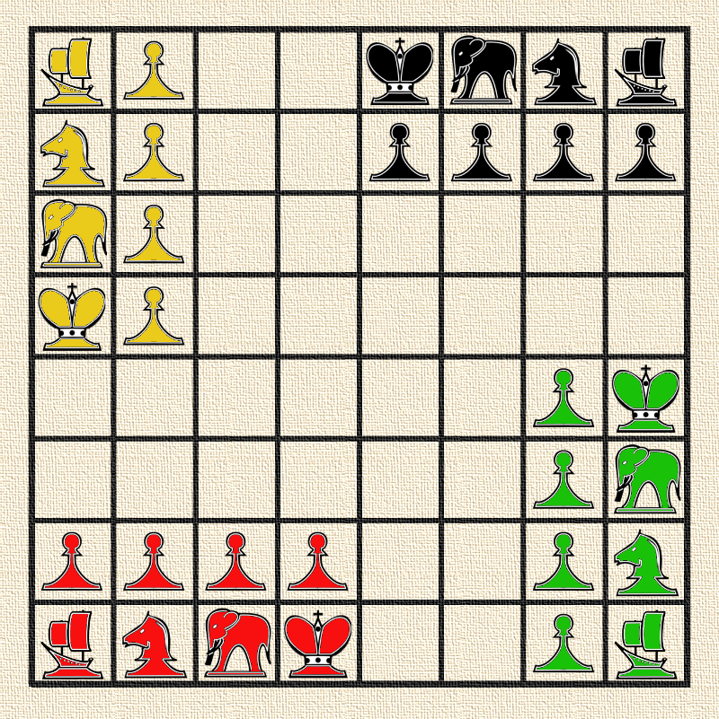
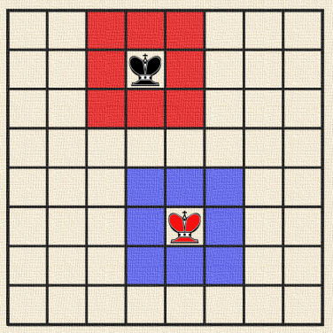
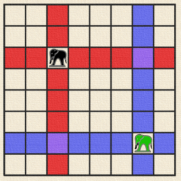
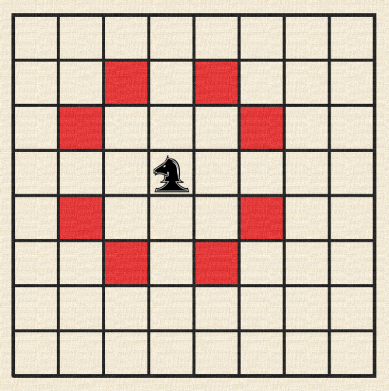
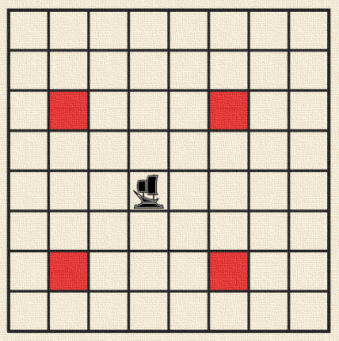
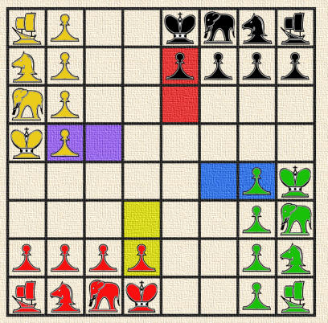
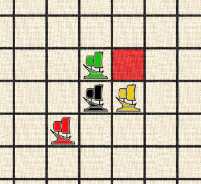
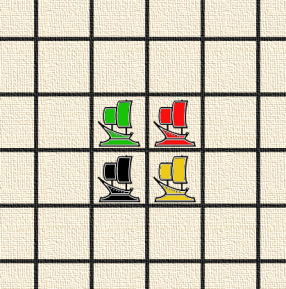

# Chaturaji

> The original rules write-up this project started from, converted from `Chaturaji.docx`
> (which remains in the repository's history) without changes to its wording. Where it and
> [rules.md](../rules.md) differ, rules.md is authoritative: the differences are deliberate
> clarifications and corrections.

## Introduction

Chaturaji, often conflated with Chaturanga, is an ancient game which may or may not be a direct ancestor of chess, however the two are certainly related. The word Chaturaji means “four Rajas” and this game is designed as and typically played by four players. I’ve found commentary neither suggesting it must be played by four players, nor to describe how two or three should play. It can be played in teams. When played in teams, typically the allies are across from each other on the board, however no commentary suggests the allies cannot be adjacent.

Unlike chess, the goal of the game was not to checkmate but to score points. Unless the only pieces left are the rajas, the game *can* continue after the rajas (the kings) are taken; moreover, rajas can be replaced. Also, unlike chess, Chaturaji is typically played with dice to introduce an element of luck, however, historically the game has also been played without dice.

As an ancient game, the traditional rules have been lost. Historians are not conclusive towards what the rules were, but there is some agreement that the rules varied depending where and when it was played. Modern interpretations of the game are certainly diverse.

The rules herein are neither an exact match for other interpretations of the game and less do they claim historical authenticity. Rather, I’ve treated various expositions are a “Chinese menu” and then had “a word with the chef” and introduced a few of my own ideas.

## Rules

### The Board

To play Chaturaji you need a 64-square board (8×8 squares) like chessboard. Traditionally, this board was not chequered. Some sources suggest many of the cells contained an “X”, but no sources suggested whether or how those cells may be important or special.

### The Dice

At the beginning of each turn (except the first player’s first move, as described below), the player may either deliberately move one piece of his/her choice, or he/she may roll two four-sided dice and move according to the results; the player may not interfere with the dice when rolling. If both numbers are the same, the same piece *can* be moved twice. Also, players can choose to skip one or both moves. Players can also be forced to skip moves (i.e., “loose a turn”) if the numbers rolled do not allow for legal movement.

| **Die value** | **Piece** |
|---|---|
| 1 | Boat |
| 2 | Horse (knight) |
| 3 or 4 | Elephant |
| 5 or 6 | Pawn or Raja (king) |

If the partner’s raja is in the player’s throne, when player roles the dice, the partner makes the second movement. If an opponent’s raja is in the player’s throne, the player must role the dice and the opponent makes the second movement. (See “Throne Squares” below.)

### The Pieces

Each of the four players has an identical set of pieces:

1. 1 raja (king)
1. 1 horse (knight)
1. 1 elephant
1. 1 boat
1. 4 pawns

The traditional colours were black, yellow, green, and red. However, there is no reason to believe these colours were always used or had significance. The pieces would start in the cells as pictured above.

Their movement and special abilities will be described below.

### The Play

#### Starting the Game

Each player rolls one four-sided die to determine who plays first. Highest roll wins. Re-roll if necessary to break ties.

The number rolled to determine the first player’s opening move and the first player does not get to roll a second die to move another piece. For example, if the first player rolled a 4, the player should move either a pawn or the raja.

After the first player moves, player turns pass clockwise around the board.

#### Piece Moves

| Piece | Moves |
|---|---|
| **Raja (king)** – moves one square in any direction (just like a king in chess). |  |
| **Elephant** – moves any number of squares vertically or horizontally, but cannot leap over other pieces (just like a rook in chess). |  |
| **Horse** – moves to a square that is two squares away horizontally and one square vertically, or two squares vertically and one square horizontally, so the complete move looks like the letter *L*. As you can see, horse moves just like knight in chess and he can “jump over” all other pieces to its destination square. |  |
| **Boat** – moves two squares diagonally in any direction. If the intervening square is occupied by opponent’s or friendly piece, boat jumps over this piece. |  |
| **Pawn –** moves one square forward to the unoccupied square immediately in front of it (except when it captures). So it moves just like a pawn in chess. You have to remember that “forward” direction is different for each player. The image below shows example moves of four pawns of different colors. Unlike chess there is neither a first double-step nor en passant. |  |

#### Captures

Just like in chess, all pieces except the pawn capture by moving to the square that the opponent’s piece occupies. Also, as in chess, the pawn captures diagonally in its general direction of movement.

##### Boat triumph (Boats parade)

There is one special move in Chaturaji called “Boat triumph” or “Boat parade”. This situation occurs when all boats meet on a 2×2 square. Example of boat triumph is shown below.

| About to form | Formed |
|---|---|
|  |  |

A player who moves last to form a full “Boat triumph” captures all opponents’ boats. In the situation shown below red boat has a chance to form a “Boat triumph” by moving to a square highlighted in red.

After a boat triumph, until the boat is captured, both the player who made the triumph and his/her partner can move the partner’s boat.

#### After Raja Capture

The game continues even after the raja is capture.

##### Return of the Raja

Players have two ways two get their raja back:

1. If both teams have captured a raja, they may exchange rajas as a ransom. The returned rajas either go back to their starting square or (if those cells are occupied) the closest free cell. In this interpretation, the player returning the raja choose which free cell of multiple squares are equidistant.
1. If a pawn crosses the board, it *may* be promoted to a raja (see promotions below).

##### Ally Regency

In this interpretation of the game, if a player does not have a raja but his/her ally does, the ally controls the player’s pieces, the same as if the ally were occupying his/her throne. However, if an opponent is actually occupying the throne, this takes priority and it is the opponent who has control (See Throne Squares).

#### Pawn Promotion

In Chaturaji pawns can be promoted to stronger pieces. If a pawn reaches the last line of the board, it is exchanged for the piece that started on the same row or column (depending upon the pawn’s general direction of movement). For examples, if a pawn started in front of an elephant and never captured any other piece, it may be promoted to an elephant. However, if the pawn which started in front of a raja captures two pieces to the right and is now in the cell where the opposite elephant began, it may also be promoted to an elephant.

However, it must be noted promotion is possible only if piece promoted to have been previously captured. So, if a player has his elephant on the board and the pawn standing in front of reached the last line, this pawn can be promoted only after losing the elephant. Until that time, the pawn cannot be moved.

Moreover, ***promotion is dependent upon the capturing player agreeing to the ransom.***

#### Ransom

Returning rajas and promoting pieces are both dependent upon “ransom”.

The player who captured the piece has the choice whether and when to return the piece.

If a player returns the piece, they retain the points for capturing the piece as well as gain points for capture of a pawn (in the event of promotion).

***Players do not need to agree to the ransom immediately after a raja is captured or when the piece may be used for promotion. Indeed, players may wait until they also have pieces they wish to promote.*** However, the ransom price is *not* negotiable (i.e., a player can’t demand two pawns or more pawns to promote a single piece).

#### Throne Squares

The starting square for each raja is the raja’s throne. If one player has his/her raja on another player’s throne, on his/her turn, he can move the occupied player’s pieces as if they were his/her own.

Moreover, on the occupied player’s turn, if the occupier is an opponent, the player must roll the dice instead of selecting the piece to move. When the dice are rolled, regardless of whether the occupier is partner or opponent, the occupier decides the second movement.

Control only lasts while the throne is occupied by the foreign power. So, in the event of enemy occupation, it behoves the ally to chase the player out.

## The goal of the game and scoring

The goal of the game is not to defeat the raja (king), as in other chess games. In Chaturaji the goal is to earn points for capturing opponents’ pieces.

### Points for Capture

The table below shows the number of points rewarded for a captured piece.

| **Piece** | **Points** |
|---|---|
| pawn | 1 point |
| boat | 2 pts |
| horse | 3 pts |
| elephant | 4 pts |
| raja (king) | 5 pts |

Points are awarded for the action of capturing, not necessarily for still having the piece prisoner at the end of the game, as the piece may have been returned as ransom. If a piece is captured multiple times, the points will be levied for each capture. Moreover, if a player accepts a pawn as ransom for another piece, this will also be scored as a capture (i.e., one point).

### Bonus Points

1. 1 additional point each time a player enters his raja on a “throne square” of opponent’s raja (leaving and re-entering will gain more points, but may be bad strategically).
1. 2 additional points if a player captures an opponent’s raja on his “throne square”; if captured by a raja entering the square, the point for entering the square is scored separately.
1. If one player commands allied pieces and two enemy rajahs were captured, we say this player “created the empire”. A team of this player is earned with:
   - 1 point for creating the empire,
   - 2 points, if player created the empire and killed the last standing enemy rajah,
   - 4 points, if last standing enemy rajah was killed on a throne square.

### Game Endings

If one player lost all his pieces, his partner plays alone to the end of the game.

If a player lost all pieces except a raja, he may (optionally) end his game. No one will earn points for capturing this raja.

If only rajas remain on the board, the game is considered a draw. It’s called “honourable peace”.

***If only one team has pieces left on the board, that team wins, and the points are disregarded.***
